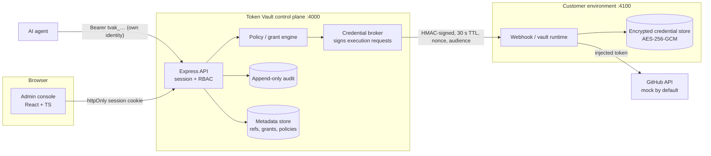

# Token Vault POC

An **identity-aware credential authorization and brokering platform for applications and AI agents**, built as a proof of concept.

It shows that an AI agent can perform an authorized GitHub operation **without ever holding the customer's long-lived provider credential**:

1. **Who is requesting access?** Every agent authenticates with its own Token Vault API credential.
2. **What is it allowed to access?** Scoped, time-bound grants per integration, operation and repository, plus explicit deny policies.
3. **Where is the credential handled?** Only inside the customer-controlled webhook / vault runtime. It is encrypted at rest there and injected into the upstream call there.

> **This is a proof of concept.** GitHub responses are simulated by default (`GITHUB_MODE=mock`). Request signing, AES-256-GCM encryption, scrypt hashing and the policy engine are real code paths, but they are **not production-hardened**. Nothing here makes a production-security claim.

---

## Quick start

Requirements: **Node.js 20.11+** (tested on Node 22) and npm 10+.

```bash
npm install
```

```bash
npm run dev
```

`npm run dev` first runs `npm run setup`. That generates `server/.env` and `webhook/.env` with random development secrets (both files are git-ignored). It then starts three processes:

| Process | URL | Trust zone |
| --- | --- | --- |
| Admin console (React + Vite) | http://localhost:5173 | Browser |
| Control plane API (Express) | http://localhost:4000 | Token Vault |
| Customer webhook / vault runtime (Express) | http://localhost:4100 | **Customer** |

Open **http://localhost:5173** and sign in with a mock demo account. The password for every account is `TokenVault-Demo-2026`.

| Account | Role | Notes |
| --- | --- | --- |
| `owner@demo.test` | Organization Owner | Member of **Demo Organization** (seeded) and **Sandbox Organization** (empty), so it sees organization selection |
| `vault.admin@demo.test` | Vault Administrator | Webhook, integrations, grants |
| `security@demo.test` | Security Administrator | Policies, grant approval, revocation |
| `developer@demo.test` | Agent Developer | Own agents only; gets **permission denied** on audit pages |
| `auditor@demo.test` | Auditor | Read-only |

Other scripts:

```bash
npm run typecheck   # all four workspaces
```

```bash
npm test            # policy engine, sanitizer, CIDR, AES-GCM and request-signature tests (Vitest)
```

```bash
npm run build       # production build of the client
```

```bash
npm run test:e2e    # Playwright: full demo script + scenarios in Chromium
```

The end-to-end suite starts all three services itself (ports 4000, 4100 and 5173 must be free), so stop `npm run dev` first. It generates throwaway secrets per run, passes them as environment variables, and uses its own webhook store in `e2e/.logs/`, so your local dev data is untouched. After the run, it fails if any token, agent credential, signing secret or encryption key appears in the server or webhook logs. If Chromium is not installed yet, run `npx -w e2e playwright install chromium` once. The HTML report is in `e2e/playwright-report/`.

CI (`.github/workflows/ci.yml`) runs typecheck, unit tests and the build on every push to `main` and every pull request, then the end-to-end suite. On failure, the Playwright report and service logs are uploaded as an artifact.

### Secrets at runtime only

If `WEBHOOK_SIGNING_SECRET` and `VAULT_ENCRYPTION_KEY` are already set in the environment, `npm run setup` (and therefore `npm run dev`) writes no `.env` files. Variables set in the environment also take precedence over any existing `.env` values. Give the webhook both variables and the control plane only `WEBHOOK_SIGNING_SECRET`.

To run the processes one at a time: `npm run dev -w server`, `npm run dev -w webhook`, `npm run dev -w client`.

---

## Demo script (5–8 minutes)

The in-app **Demo guide** (sidebar footer) repeats this with direct links.

1. Sign in as `owner@demo.test` and choose **Sandbox Organization** to show the empty first-run state.
2. **Webhook / Vault Agent → Webhook Setup**: register `http://localhost:4100`, then send the signed health challenge.
3. **Integrations → Integration Catalog → GitHub → Connect**: enter any mock token, such as `mock_ghp_` followed by 20 or more characters. **Never use a real token in a demo.**
4. Point out that only a credential reference, a masked identifier and a keyed fingerprint are displayed.
5. **Agents → Register agent** "GitHub Assistant". Copy the one-time credential and click **Use in Playground**.
6. **Access Grants → Create grant**: allow *Read repository metadata* and *Create issue*, restricted to `demo-org/demo-repo`.
7. **Access Playground**: run preset **A** (allowed, simulated 201 from GitHub), then **B** (explicit deny policy) and **C** (resource restriction).
8. **Audit & Activity → Access Logs**: show both decisions and open one to see the decision trace.
9. Revoke the grant, then run preset **D**. The previously allowed request is now denied with `GRANT_REVOKED`.
10. Open **Security Events** and the grant detail page to show traceability.

Switch to **Demo Organization** for the seeded data and the remaining scenarios:

| Scenario | How to trigger it in the Playground | Result |
| --- | --- | --- |
| A: Successful access | Preset A | `ALLOW`, upstream 201 |
| B: Scope violation | Preset "Destructive operation" / "Scope denied" | `POLICY_DENIED` / `SCOPE_DENIED` |
| C: Resource restriction | Preset C (`demo-org/other-repo`) | `RESOURCE_DENIED` |
| D: Revoked grant | Revoke "GitHub Issue Creation", then preset D | `GRANT_REVOKED` |
| E: Expired grant | Preset E (seeded staging grant expired yesterday), or **Expire now** on any grant | `GRANT_EXPIRED` |
| F: Webhook unavailable | Preset F → **Simulate outage** (or stop the webhook process) | Authorized, but execution fails safely: `WEBHOOK_UNAVAILABLE` |
| Unauthorized agent | Preset "Unauthorized agent" | `AGENT_UNAUTHENTICATED` (HTTP 401) |
| Missing grant | Preset "Missing grant" (Partner GitHub) | `GRANT_MISSING` |
| Integration unavailable | Disable the integration, then send any request | `INTEGRATION_UNAVAILABLE` |
| Upstream provider error | Preset "Upstream provider error" | `UPSTREAM_ERROR` (mock GitHub returns 500) |
| Rate limit exceeded | Preset "Rate limit exceeded" (12 requests; limit is 10/min) | `RATE_LIMITED` (HTTP 429) |
| Malformed request | Preset "Malformed request" | `MALFORMED_REQUEST` (HTTP 400) |

> Seeded agents are created with random API keys that are discarded immediately, so nobody knows them. In the Playground, click **Get a credential**. This rotates the agent's key and loads the new key into page memory only.

**Reset:** use **Settings → Organization → Reset demo data** or the button on the Demo guide (Owner only). Restarting the API also reseeds it, because control-plane data is held in memory.

---

## Architecture



**Agent request flow** (spec Flow B):

1. The agent calls `POST /agent/v1/execute` with `Authorization: Bearer tvak_<keyId>_<secret>`. Its identity is derived from that credential. No agent ID supplied by the caller is ever trusted.
2. The control plane verifies the scrypt hash, then runs the deterministic engine in this order: agent active → **explicit DENY policies** → grant exists and is active → validity window → integration active → scope → resource → rate limit → source IP. Any failed check means deny.
3. On ALLOW, the broker sends the customer webhook a signed execution request containing `request_id`, `iat`, `exp` (+30 s), `nonce`, `aud` (the webhook instance ID) and the credential **reference**.
4. The webhook verifies the HMAC, timestamp window, nonce (replay cache), audience, expiry and organization. It then decrypts the credential in memory, calls GitHub, and returns a **sanitized**, signed response.
5. Every decision, allowed or denied, writes an access request record and an audit event.

Revocation needs no token expiry: grant state is evaluated on every request, so revocation takes effect on the next authorization check.

### Repository layout

```
token-vault/
├── package.json              npm workspaces + root scripts
├── scripts/setup.mjs         generates server/.env and webhook/.env (random secrets)
├── shared/                   @token-vault/shared: domain types, operation catalog, RBAC matrix, decision codes
├── server/                   Control plane (Express modular monolith)
│   ├── src/
│   │   ├── app.ts            router composition (admin API /api/v1, agent API /agent/v1)
│   │   ├── config.ts
│   │   ├── lib/              crypto (scrypt, HMAC), ids, CIDR matching, sanitizer, zod validation
│   │   ├── middleware/       session auth + RBAC, logging (no bodies), security headers, error handler
│   │   ├── store/            in-memory repository (mirrors the spec data model), seed data, DTO views
│   │   └── modules/
│   │       ├── auth/             login, org selection, forgot-password placeholder
│   │       ├── organizations/    org settings, members & roles
│   │       ├── webhooks/         registry, signed client, health checks + heartbeat
│   │       ├── integrations/     catalog, credential registration/rotation (forwarded, never stored)
│   │       ├── agents/           registry, one-time credential issuance, API clients
│   │       ├── grants/           create, revoke, approve, extend, versioning, expire-now (demo)
│   │       ├── policies/         CRUD for ALLOW/DENY rules
│   │       ├── policy-engine/    pure deterministic evaluator (unit tested)
│   │       ├── broker/           agent execution API + credential broker
│   │       ├── audit/            append-only access requests + audit events
│   │       ├── dashboard/        overview aggregation
│   │       └── demo/             reset
│   └── test/engine.test.ts
├── webhook/                  Customer webhook / vault runtime (separate process, customer trust zone)
│   ├── src/
│   │   ├── security/         HMAC verification + replay cache, AES-256-GCM sealing, masking
│   │   ├── store/            encrypted credential store (ciphertext persisted to webhook/data/, git-ignored)
│   │   ├── providers/        GitHub connector (mock + live), response allow-listing
│   │   └── routes.ts         /internal/v1/{health,credentials,execute} (all signature-protected)
│   └── test/security.test.ts
├── client/                   Admin console (React 18 + TypeScript + Vite + Tailwind + Lucide)
│   └── src/
│       ├── components/ui/    reusable component library (button, card, badge, form, dialog, drawer, table, tabs, stepper, toast, secret)
│       ├── components/       AppShell (sidebar + header), guards, TrustBoundary diagram
│       ├── context/          Auth (session), Playground (in-memory agent credential)
│       ├── hooks/useApi.ts   data fetching + mutations
│       ├── lib/              API client, formatting utils
│       └── pages/            one file per screen (see docs/SCREEN_MAP.md)
└── docs/
    ├── SCREEN_MAP.md         information architecture, screen map, journeys
    └── API.md                endpoint reference
```

---

## Security model: what is real and what is simulated

| Concern | POC implementation | Production direction |
| --- | --- | --- |
| Provider secrets | Sent browser → control plane (TLS in prod) → webhook, **never persisted** by the control plane. They are removed from the request object after forwarding and are not logged. | Same, or direct browser → webhook upload |
| Encryption at rest | AES-256-GCM in the webhook, with the credential ref bound as AAD. The key comes from `webhook/.env` and is never stored with the ciphertext. | KMS/HSM envelope encryption |
| Control plane ↔ webhook | Shared-secret HMAC-SHA256 over method, path, timestamp, nonce and body hash. Responses are signed too. 60 s skew window and a nonce replay cache. | mTLS or asymmetric signatures with rotation |
| Webhook identity | A signed challenge/response at registration and on every heartbeat. The instance ID is pinned. | Certificate-bound identity |
| Agent credentials | `tvak_<keyId>_<secret>`. Only a **scrypt hash** is stored. Shown once. Rotation invalidates the old key immediately. | Same, plus optional workload identity federation |
| Admin sessions | Opaque token in an **httpOnly, SameSite=Strict** cookie. Nothing is kept in `localStorage`. | Enterprise SSO (out of scope) |
| Playground agent key | React state only. Lost on reload. Never placed in storage or URLs. | n/a |
| Audit | Append-only (frozen records), with a sanitizer that redacts secret-looking keys and values | Immutable store (WORM / ledger) |
| Org isolation | Every query is scoped by `organizationId`. The webhook also checks `org_id` on each credential. | Same, plus row-level security |
| Logs | Method, path, status and latency only. No bodies, headers or query strings. | Structured logging with redaction |
| Upstream GitHub | **Simulated** by default. Set `GITHUB_MODE=live` in `webhook/.env` to call api.github.com. | Use a dedicated test org and a fine-grained PAT with minimum scopes |

### Deviations from the specification

- **React + Vite instead of Next.js.** You asked for React with an Express backend, so the client is a Vite SPA with React Router. Same stack otherwise: TypeScript, Tailwind, Lucide.
- **Shadcn UI is not installed.** An equivalent component library was hand-written in `client/src/components/ui` in the same style. It has no CLI or codegen dependency.
- **In-memory store instead of PostgreSQL/Prisma.** `server/src/store/db.ts` mirrors the spec's tables and is the only place services touch storage, so swapping in Prisma or Drizzle repositories is contained. The webhook persists ciphertext to a JSON file.
- **Shared-secret HMAC** instead of mTLS, as the spec allows for a local POC. mTLS appears in the webhook wizard as the production design and is disabled.
- **Redis is not used.** Rate limiting, the nonce cache and idempotency are in-process.
- **Explicit DENY policies are evaluated before grant checks.** This makes "explicit deny takes precedence" observable: a destructive operation reports the matched deny policy instead of a generic scope error.

---

## Configuration

`server/.env` (control plane):

| Variable | Purpose |
| --- | --- |
| `PORT` | API port (4000) |
| `WEBHOOK_SIGNING_SECRET` | HMAC secret shared with the webhook (32+ bytes) |
| `DEFAULT_WEBHOOK_URL` | Pre-filled webhook URL and the seeded webhook endpoint |
| `HEARTBEAT_INTERVAL_MS` | Signed health-check interval (default 30000) |

`webhook/.env` (customer zone):

| Variable | Purpose |
| --- | --- |
| `PORT` | Webhook port (4100) |
| `WEBHOOK_SIGNING_SECRET` | Must match the control plane |
| `VAULT_ENCRYPTION_KEY` | Base64 of 32 random bytes. AES-256 key for the credential store |
| `WEBHOOK_INSTANCE_ID` | Identity pinned by the control plane (signature audience) |
| `GITHUB_MODE` | `mock` (default) or `live` |

If you regenerate `VAULT_ENCRYPTION_KEY`, records encrypted under the old key can no longer be decrypted and are dropped at startup. The seeded mock credentials are recreated automatically.

## Troubleshooting

- **Webhook shows Unhealthy / verification fails:** make sure the webhook process is running on :4100 and that `WEBHOOK_SIGNING_SECRET` is identical in both `.env` files. Delete both files and run `npm run setup` to regenerate them as a pair.
- **Playground says "Agent credential required":** click **Get a credential**. Keys live only in page memory and are cleared on reload.
- **"Agent credential is invalid, rotated or unknown":** the key was rotated, or the demo was reset. Issue a new one.
