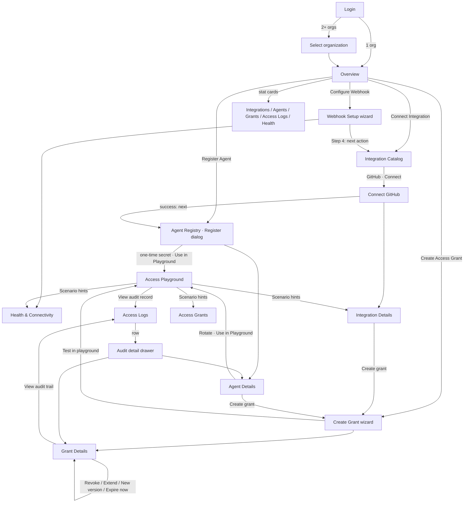
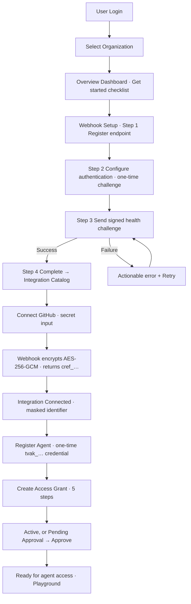
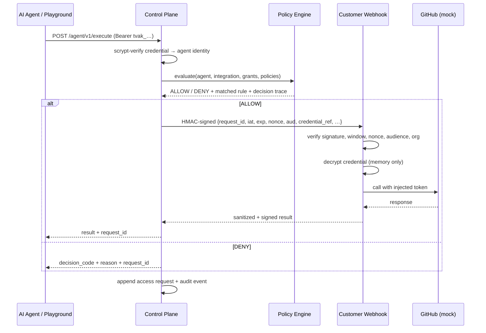
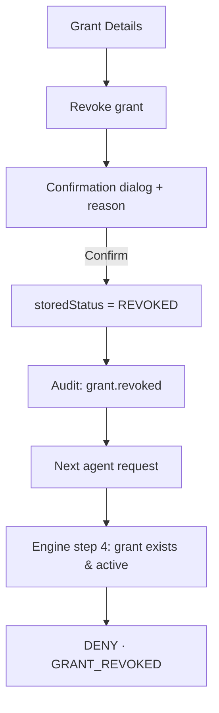

# Screen Map and Application Flow

## Information architecture

```text
Token Vault
├── Overview                         /                         pages/OverviewPage.tsx
├── Integrations
│   ├── Integration Catalog          /integrations/catalog     pages/integrations/CatalogPage.tsx
│   ├── Connect GitHub               /integrations/connect/github   ConnectIntegrationPage.tsx
│   ├── Connected Integrations       /integrations/connected   ConnectedIntegrationsPage.tsx
│   ├── Integration Details          /integrations/:id         IntegrationDetailPage.tsx
│   └── Credential Status            /integrations/credentials CredentialStatusPage.tsx
├── Agents
│   ├── Agent Registry (+ Register)  /agents[?register=1]      pages/agents/AgentRegistryPage.tsx
│   └── Agent Details (4 tabs)       /agents/:id               AgentDetailPage.tsx
├── Access Management
│   ├── Access Grants                /access/grants            pages/access/GrantsPage.tsx
│   ├── Create Access Grant (5 steps)/access/grants/new        CreateGrantPage.tsx
│   ├── Grant Details                /access/grants/:id        GrantDetailPage.tsx
│   └── Policies                     /access/policies          PoliciesPage.tsx
├── Access Playground (Demo)         /playground               pages/PlaygroundPage.tsx
├── Webhook / Vault Agent
│   ├── Webhook Setup (4-step wizard)/webhook/setup            pages/webhook/WebhookSetupPage.tsx
│   └── Health & Connectivity        /webhook/health           WebhookHealthPage.tsx
├── Audit & Activity
│   ├── Access Logs (+ detail drawer)/audit/access-logs        pages/audit/AccessLogsPage.tsx
│   └── Security Events              /audit/security-events    SecurityEventsPage.tsx
├── Settings
│   ├── Organization                 /settings/organization    pages/settings/OrganizationSettingsPage.tsx
│   ├── Members & Roles              /settings/members         MembersPage.tsx
│   └── API Clients                  /settings/api-clients     ApiClientsPage.tsx
└── Demo guide                       /guide                    pages/DemoGuidePage.tsx

Public: Login /login · Organization selection /select-org
```

## Screen-to-screen navigation



## Primary journeys

### Flow A: Initial organization setup



### Flow B: Agent access request



### Flow C: Revocation



## UI states covered

| State | Where |
| --- | --- |
| Loading | Skeleton tables and page skeletons (`components/ui/feedback.tsx`), button spinners |
| Empty | Every list, with a call-to-action (e.g. "No agents registered → Register agent") |
| Validation errors | Inline field errors from client checks and server `fields` details (zod) |
| Error | `ErrorState` with retry; network failure message when the API is down |
| Success | Toasts plus success panels (integration connected, grant created, webhook connected) |
| Permission denied | Route-level `RequirePermission` (audit for Developer), action buttons hidden by role, server 403 surfaced |
| Confirmation | Revoke, disable, delete (typed confirmation), rotate, reset demo |
| One-time secret | `SecretOnceDialog` (acknowledgement checkbox, no re-display) |
| Status labels | Connected, Disconnected, Healthy, Unhealthy, Active, Revoked, Expired, Denied, Pending, Superseded, Scheduled |
